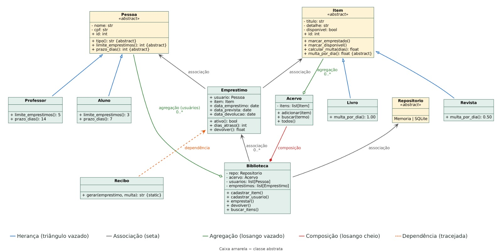

# Sistema de Biblioteca

Sistema de gerenciamento de biblioteca, desenvolvido em **Python** para a disciplina **Orientação a Objetos** (UnB).

## Finalidade

Simular a rotina de uma biblioteca: cadastro de livros e revistas, cadastro de alunos e professores, empréstimos, devoluções e cálculo de multa por atraso.

O projeto aplica herança, polimorfismo, composição, associação e dependência (além de agregação e encapsulamento), com modelagem em UML.

## Níveis do projeto

| Nível | Propósito | Interface | Vídeo | Commit de entrega | Status |
|:-----:|-----------|:---------:|:-----:|:-----------------:|:------:|
| 1 | Modelagem em UML (diagrama de classes) e testes das funcionalidades | Terminal (`teste_rapido.py`) | [Link](https://youtu.be/Jyrq_PwBc_s) | `A definir` | Concluído |
| 2 | Menu funcional: o usuário navega pelas funcionalidades do sistema, sem banco de dados | Terminal (menu) | Em breve | `A definir` | Pendente |
| 3 | Persistência dos dados em banco de dados (SQLite) | Terminal (menu, `--db`) | Em breve | `A definir` | Pendente |
| 4 | Interface gráfica, com o sistema funcionando em janelas | Janelas (GUI) | Em breve | `A definir` | Pendente |

## Modelagem em UML



## Relações de orientação a objetos

| Relação | Onde está | Arquivo |
|---------|-----------|---------|
| Herança | `Aluno` e `Professor` herdam de `Pessoa`; `Livro` e `Revista` herdam de `Item` | `modelos.py` |
| Polimorfismo | `prazo_dias` (7 dias para aluno, 14 para professor) e `multa_por_dia` (livro e revista) | `modelos.py` |
| Composição | A `Biblioteca` cria o `Acervo` dentro dela | `biblioteca.py` |
| Agregação | O `Acervo` guarda itens criados fora dele | `modelos.py` |
| Associação | O `Emprestimo` liga uma `Pessoa` a um `Item` | `modelos.py` |
| Dependência | O `Recibo` usa o `Emprestimo` sem guardá-lo | `modelos.py` |
| Encapsulamento | O estado do item só muda por `marcar_emprestado()` | `modelos.py` |

## Estrutura dos arquivos

| Arquivo | Função |
|---------|--------|
| `modelos.py` | Classes do domínio: pessoas, itens, empréstimo, acervo e recibo |
| `biblioteca.py` | Regras de negócio: cadastrar, emprestar e devolver |
| `repositorio.py` | Armazenamento: em memória e em SQLite |
| `app_terminal.py` | Menu em terminal |
| `app_gui.py` | Interface gráfica |
| `teste_rapido.py` | Testes automáticos das regras |
| `uml.png` | Modelagem em UML |

## Como rodar

É necessário ter o Python 3 instalado. Abra um terminal na pasta do projeto e use:

```bash
python3 teste_rapido.py        # testes automáticos
python3 app_terminal.py        # menu em terminal, sem banco de dados
python3 app_terminal.py --db   # menu em terminal, com banco de dados SQLite
python3 app_gui.py             # interface gráfica
```

Se o seu sistema usa `python` em vez de `python3`, troque o comando.

## Autores

- Ana Clara Cheim de Matos
- Annabely Andrade Vieira
